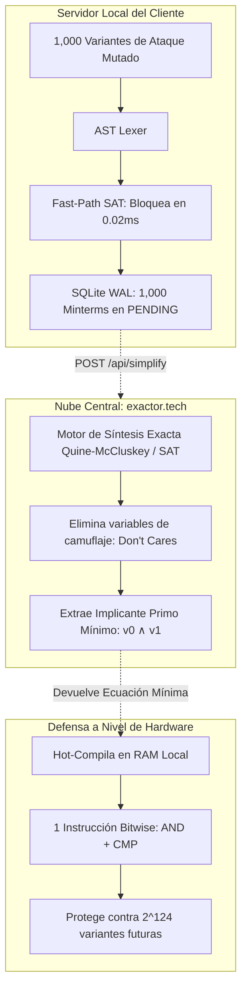
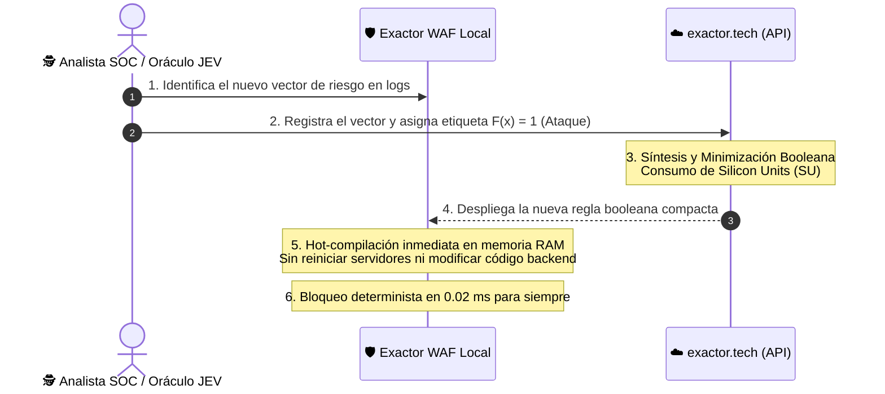

# 📘 Supervisión Axiomática y Síntesis Inductiva en EXACTOR
## Fundamento Epistémico: Cómo aprende, clasifica y generaliza el WAF sin etiquetado humano

---

### Resumen Ejecutivo

Una de las preguntas más críticas y disruptivas sobre el paradigma de **EXACTOR WAF Guardian** es:  
> *«Si el entrenamiento de EXACTOR no es supervisado por humanos etiquetando datos a mano... ¿cómo sabe el sistema qué es un ataque y qué no? Y si los invariantes ya detectan los ataques... ¿para qué se necesita entrenar?»*

La respuesta reside en la transición de la **Inteligencia Artificial Probabilística** (redes neuronales basadas en aproximaciones estadísticas) a la **Computación Neuro-Simbólica y el Álgebra Booleana Exacta**:

1. **La Etiqueta es un Teorema:** El WAF no adivina ni calcula probabilidades; la etiqueta $F(\mathbf{x}) = 1$ (*Es un Ataque*) surge de la **Supervisión Axiomática** impuesta por las gramáticas formales de los protocolos.
2. **El Entrenamiento es Síntesis Inductiva:** El entrenamiento en la nube ([`https://exactor.tech/api/simplify`](https://exactor.tech/api/simplify)) no ajusta pesos neuronales; **elimina el camuflaje** (*Don't Cares*), extrae el **Implicante Primo Mínimo** y generaliza la protección contra trillones de variantes futuras en una sola instrucción de microprocesador.
3. **El Valor Comercial:** Este cómputo de síntesis lógica de alta densidad es el núcleo donde se consumen y facturan las **Silicon Units (SU)**.

---

## 1. ¿Quién le pone la "etiqueta" de que es un ataque? (La Supervisión Axiomática)

En el Machine Learning tradicional (Deep Learning, clasificadores probabilísticos, Random Forests), el entrenamiento requiere miles o millones de ejemplos etiquetados manualmente por humanos:
$$\mathcal{D}_{\text{Tradicional}} = \{(x_1, y_1), (x_2, y_2), \dots, (x_m, y_m)\}, \quad y_i \in \{0, 1\}$$
Donde humanos deben clasificar: *"este texto es benigno ($y=0$), este texto es malicioso ($y=1$)"*.

En ciberseguridad perimetral y bancaria de alta frecuencia, este enfoque es **inviable y peligroso**:
- Depende de la subjetividad humana o del sesgo estadístico de los datasets.
- Produce **falsos positivos catastróficos** cuando el tráfico legítimo contiene sintaxis compleja no contemplada en el entrenamiento.

### El Enfoque Exactor: Las Gramáticas Formales como Axiomas
Las vulnerabilidades informáticas dependen de **leyes matemáticas y restricciones gramaticales rígidas** (especificadas en RFCs, gramáticas BNF de SQL, W3C DOM, JSON RFC 8259, GraphQL y RFC 7519 de JWT):

```text
┌────────────────────────────────────────────────────────────────────────┐
│                   SUPERVISIÓN AXIOMÁTICA DETERMINISTA                  │
├───────────────────────────────────┬────────────────────────────────────┤
│ DOMINIO SINTÁCTICO                │ INVARIANTE FORMAL DE SEGURIDAD     │
├───────────────────────────────────┼────────────────────────────────────┤
│ SQL Relacional                    │ Imposibilidad de alterar la        │
│ (RFC / Gramática BNF)             │ cardinalidad con tautologías       │
│                                   │ o inyecciones UNION no tipadas.    │
├───────────────────────────────────┼────────────────────────────────────┤
│ JavaScript / Node.js Engine       │ Prohibición de mutar las           │
│ (ECMAScript Spec)                 │ propiedades reservadas __proto__   │
│                                   │ o constructor.prototype.           │
├───────────────────────────────────┼────────────────────────────────────┤
│ Autenticación Criptográfica       │ Nulidad de tokens con algoritmo    │
│ (JWT RFC 7519)                    │ "none" o sin firma criptográfica.  │
├───────────────────────────────────┼────────────────────────────────────┤
│ GraphQL AST Specification         │ Profundidad recursiva acotada      │
│ (GraphQL Foundation)              │ y bloqueo de introspección schema. │
└───────────────────────────────────┴────────────────────────────────────┘
```

Cuando una petición web llega a **Exactor WAF Guardian**, el **AST Lexer** la normaliza y extrae sus tokens estructurales. Si la petición viola cualquiera de las **10 Islas de Certeza**, el motor asigna:
$$\mathbf{F(\mathbf{x}) = 1 \quad \implies \quad \text{ETIQUETA FORMAL: ES UN ATAQUE}}$$

> **Conclusión Epistémica:**  
> La etiqueta $F(\mathbf{x}) = 1$ no es una estimación probabilística ni la opinión de un moderador humano. Es un **teorema formal comprobado por el SAT Solver en microsegundos**: *la petición contiene una combinación de primitivas que busca forzar al intérprete a violar su especificación de seguridad.*

---

## 2. La Gran Paradoja: *"Si el WAF ya sabe que es un ataque por el invariante... ¿para qué se necesita entrenar?"*

Esta es la pieza donde todo encaja a nivel computacional y financiero.

### El Problema de la Mutación y el Camuflaje
Cuando un atacante (o una botnet automatizada) detecta que un firewall bloquea un vector simple como `' OR 1=1`, no se detiene. Empieza a **mutar el ataque agregando capas de ofuscación y camuflaje**:

* **Ataque 1:** Envía el SQLi con comentarios en línea:  
  `id=1'/*foo*/OR/*bar*/1=1--`  
  *(Activa: $v_0$ comilla, $v_1$ tautología, $v_{16}$ ofuscación de comentarios)*.
* **Ataque 2:** Envía el SQLi dentro de un payload JSON de 2 MB con caracteres nulos:  
  *(Activa: $v_0$ comilla, $v_1$ tautología, $v_{20}$ cuerpo grande, $v_{21}$ byte nulo)*.
* **Ataque 3:** Envía el SQLi con un User-Agent falsificado y codificación URL recursiva:  
  *(Activa: $v_0$ comilla, $v_1$ tautología, $v_{17}$ user-agent sospechoso, $v_{23}$ cabecera inusual)*.
* **Ataques 4 a 1,000:** La botnet dispara **1,000 combinaciones distintas** de parámetros intentando encontrar una fuga en el perímetro.

### ¿Qué ocurriría si NO existiera el Entrenamiento?
El WAF local va a bloquear los 1,000 ataques en tiempo real gracias a sus invariantes básicos. Sin embargo, en el hipercubo booleano $\{0, 1\}^{128}$, cada una de las 1,000 variantes representa un **mintérmino específico diferente**:
- Si el WAF intentara almacenar cada variante como una regla puntual en memoria RAM, **el servidor del cliente colapsaría por saturación de memoria y latencia de búsqueda**.
- Almacenar miles de casos específicos es ineficiente y no previene mutaciones futuras que el atacante invente mañana.

---

### ¿Qué hace el "Entrenamiento" en `exactor.tech`? (Síntesis Inductiva)

El WAF toma los 1,000 mintérminos registrados en el SQLite WAL local (`waf_ledger.db`), todos etiquetados formalmente con $F=1$ (ataques confirmados), y los envía en segundo plano al servicio de síntesis:

```text
POST https://exactor.tech/api/simplify
{
  "variables": ["v0_quote", "v1_tautology", "v16_obfuscated", "v20_large_body", ...],
  "minterms": [34359738368, 34359738369, 549755813888, ...] // 1,000 mintérminos
}
```



#### Los 3 Efectos Revolucionarios de la Síntesis:
1. **Eliminación del Camuflaje (*Don't Cares*):**  
   El algoritmo matemático analiza las adyacencias dimensionales en el hipercubo y demuestra formalmente que las variables de camuflaje ($v_{16}, v_{20}, v_{21}, v_{17}, v_{23}$) son irrelevantes para la condición de ataque.
2. **Extracción del Implicante Primo Mínimo:**  
   Colapsa los 1,000 casos dispersos en la regla raíz canónica irreducible:
   $$\text{Implicante Primo} = v_0 \land v_1$$
3. **Generalización Inductiva Total ($100\%$ Exacta):**  
   Al compilar esa regla raíz en la memoria local del WAF, el sistema **no solo bloquea los 1,000 casos que ya vio**, sino que **inmuniza instantáneamente al servidor contra cualquiera de las $2^{128-2} = 2^{126}$ posibles combinaciones futuras** que un atacante intente crear con ese núcleo.
4. **Optimización Extrema:**  
   Reduce 1,000 reglas en base de datos a **una sola instrucción bitwise a nivel de registros de CPU (`AND & CMP`)**, ejecutada en menos de $0.001\text{ ms}$.

---

## 3. ¿Y qué pasa con ataques completamente nuevos (Zero-Days Semánticos)?

¿Qué ocurre si aparece un vector de ataque inédito que no rompe una gramática universal estándar, sino una **vulnerabilidad de lógica de negocio propia del cliente**?

*Ejemplo:*  
En la aplicación bancaria del cliente, una llamada a `POST /api/wire-transfer` que incluya un header no documentado `X-Debug-Role: superadmin` permite vaciar una cuenta sin autenticación.

En este escenario entra la **Supervisión Externa (Humana o de Oráculo)**:



1. **Detección:** El equipo de seguridad del cliente (o un agente cognitivo como JEV / LLM analizando patrones fuera de línea) identifica el nuevo vector.
2. **Asignación de Etiqueta:** Se marca esa firma con $F(\mathbf{x}) = 1$.
3. **Síntesis en la Nube:** Se despacha a `https://exactor.tech/api/simplify`.
4. **Hot-Patching en Tiempo Real:** El WAF local descarga la regla y la incorpora a sus cláusulas dinámicas en microsegundos.
5. **Resultado:** El cliente queda protegido a velocidad de hardware **sin haber tenido que esperar semanas a que sus programadores parchen el backend y sin reiniciar sus servidores**.

---

## 4. La Conexión con el Modelo de Negocio: Silicon Units (SU)

Este mecanismo fundamenta la viabilidad comercial y la rentabilidad del producto:

* **El Tráfico Diario es Gratuito en Inferencia:**  
  Las millones de visitas legítimas de clientes comprando o consultando la web se resuelven en la memoria RAM local a **costo marginal $0.00**. Esto hace que la oferta sea irresistible para el cliente frente a servicios que cobran por petición o por volumen de datos.
* **El Cobro ocurre en el Aprendizaje (Cerebro):**  
  Cada vez que el WAF local empaqueta hipercubos de ataques mutados para generalizar la defensa, o cuando el cliente sintetiza nuevas reglas para sus APIs, se ejecuta el algoritmo de síntesis de alta densidad en la nube.
* **Medición en Silicon Units (SU):**  
  Cada simplificación booleana descuenta **Silicon Units (SU)** según la complejidad combinatoria:
  $$\text{Consumo SU} = \text{Mintérminos} \times \phi(\text{Variables})$$
  - El cliente contrata un plan mensual con una bolsa de SU (ej. Plan STARTUP con 50,000 SU por $499 USD/mes).
  - Si una oleada de ataques o nuevas APIs supera su cuota, se factura el exceso (**$8 USD por cada 1,000 SU extra**).

---

## 5. Cuadro Comparativo: Paradigmas de Detección

| Característica | Machine Learning Clásico (Deep Learning) | Expresiones Regulares (ModSecurity / CRS) | EXACTOR (Supervisión Axiomática + SAT) |
| :--- | :---: | :---: | :---: |
| **Origen de la Etiqueta** | Subjetiva (Etiquetado humano manual) | Manual (Firmas fijas de analistas) | **Axiomática (Teoremas sobre gramáticas formales)** |
| **Naturaleza de la Decisión** | Probabilística (Score $0.0 - 1.0$) | Coincidencia de texto (String match) | **Determinista SAT ($\text{TRUE} \lor \text{FALSE}$)** |
| **Resistencia al Camuflaje** | Vulnerable a ataques adversarios | Vulnerable a evasión por encoding | **Absoluta (Generalización por Implicantes Primos)** |
| **Latencia de Evaluación** | Inaceptable ($350 - 650\text{ ms}$) | Lenta / Variable ($2 - 10\text{ ms}$) | **Ultra-Rápida ($< 0.05\text{ ms}$ / $< 20\text{ µs}$)** |
| **Explicabilidad** | Opaca (Caja negra) | ID de regla genérico | **Formal ($\LaTeX$ y Cadenas Causales)** |
| **Costo por Inferencia** | Elevado (Tokens / GPUs) | Medio (Consumo de CPU por ReDoS) | **Cero ($0.00$ marginal en CPU local)** |
| **Monetización** | Cobro por token de LLM | Venta de suscripción estática | **Suscripción Base + Silicon Units (SU)** |

---

### Referencias y Documentación Relacionada
- [Metodología de Ciberdefensa Determinista SAT](file:///d:/proyectos/rush/exactor-waf-guardian/EXACTOR_METHODOLOGY.md)
- [Prueba de Concepto y Duelo Multi-Agente](file:///d:/proyectos/rush/exactor-waf-guardian/PROOF_OF_CONCEPT.md)
- [Reglas Oficiales de Licenciamiento y Planes de Silicon Units](file:///d:/proyectos/rush/.agent/rules/pricing_and_licensing.md)
- [README Principal de Exactor WAF Guardian](file:///d:/proyectos/rush/exactor-waf-guardian/README.md)
