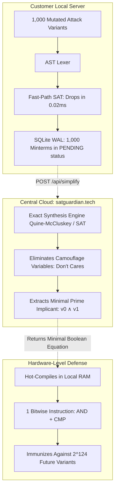
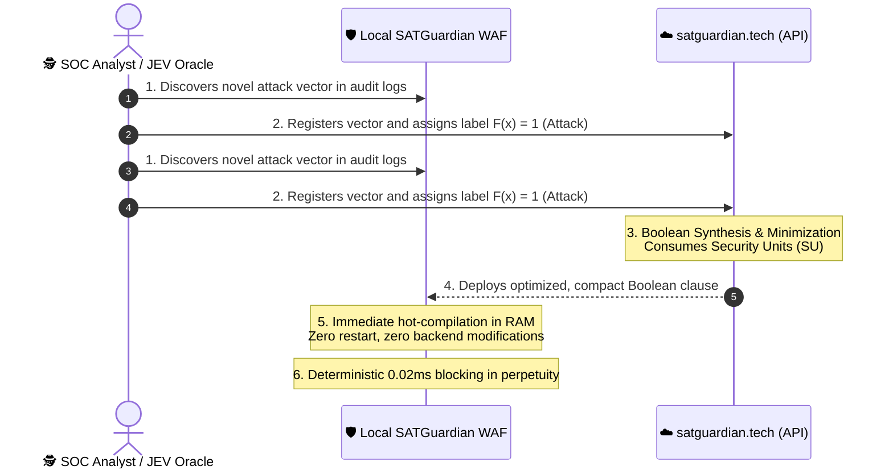

# 📘 Inspección Estructurada y Síntesis Offline de Reglas
## Principios de Diseño: Evaluación Lógica, Parsers Estructurados y Optimización Asíncrona

---

### Executive Summary

One of the most critical and Pragmático questions regarding the **SATGuardian Edge WAF** paradigm is:  
> *“If SATGUARDIAN training is not supervised by humans labeling datasets by hand... how does the system know what constitutes an attack and what is benign? And if formal invariants already detect attacks... why is training needed at all?”*

The answer lies in the transition from **Probabilistic Artificial Intelligence** (neural networks based on statistical curve fitting) to **Neuro-Symbolic Computing and Exact Boolean Algebra**:

1. **The Label is a Mathematical Theorem:** The WAF neither guesses nor computes statistical probabilities; the classification label $F(\mathbf{x}) = 1$ (*Confirmed Attack*) originates from **Inspección Basada en Gramáticas Estructuradas** enforced by formal protocol grammars.
2. **Training is Inductive Synthesis:** Cloud training ([`https://satguardian.tech/api/simplify`](https://satguardian.tech/api/simplify)) does not tune weight matrices; it **strips obfuscation camouflage** (*Don't Cares*), extracts the **Minimal Prime Implicant**, and generalizes protection against trillions of future variants into a single microprocessor instruction.
3. **Commercial Model:** This high-density logic synthesis computation is the engine through which **Security Units (SU)** are consumed and monetized.

---

## 1. Who Labels the Payload as an Attack? (Inspección Basada en Gramáticas Estructuradas)

In traditional Machine Learning (Deep Learning, probabilistic classifiers, Random Forests), model training requires millions of manually curated examples labeled by humans:
$$\mathcal{D}_{\text{Traditional}} = \{(x_1, y_1), (x_2, y_2), \dots, (x_m, y_m)\}, \quad y_i \in \{0, 1\}$$
where human reviewers decide: *"this payload is benign ($y=0$), this payload is malicious ($y=1$)"*.

In high-frequency banking and edge perimeter cybersecurity, this approach is **fundamentally flawed and hazardous**:
- It introduces human subjectivity and statistical dataset bias.
- It produces **catastrophic false positives** when legitimate application traffic carries complex syntax not represented in the training distribution.

### The SATGUARDIAN Approach: Formal Grammars as Axioms
Computer vulnerabilities obey **mathematical laws and rigid grammatical constraints** defined across formal standards (RFCs, BNF SQL grammars, W3C DOM specifications, JSON RFC 8259, GraphQL AST, and JWT RFC 7519):

```text
┌────────────────────────────────────────────────────────────────────────┐
│                   DETERMINISTIC Inspección Basada en Gramáticas Estructuradas                  │
├───────────────────────────────────┬────────────────────────────────────┤
│ SYNTACTIC DOMAIN                  │ FORMAL SECURITY INVARIANT          │
├───────────────────────────────────┼────────────────────────────────────┤
│ Relational SQL                    │ Impossibility of altering result   │
│ (RFC / BNF Grammar)               │ cardinality via tautologies or     │
│                                   │ untyped UNION exfiltration.        │
├───────────────────────────────────┼────────────────────────────────────┤
│ JavaScript / Node.js Engine       │ Absolute prohibition against       │
│ (ECMAScript Spec)                 │ mutating reserved prototype keys:  │
│                                   │ __proto__ or constructor.prototype │
├───────────────────────────────────┼────────────────────────────────────┤
│ Cryptographic Authentication      │ Automatic invalidation of tokens   │
│ (JWT RFC 7519)                    │ using algorithm "none" or missing  │
│                                   │ cryptographic signatures.          │
├───────────────────────────────────┼────────────────────────────────────┤
│ GraphQL AST Specification         │ Strictly bounded recursion depth   │
│ (GraphQL Foundation)              │ and blocked schema introspection.  │
└───────────────────────────────────┴────────────────────────────────────┘
```

When an HTTP request enters **SATGuardian Edge WAF**, the **AST Lexer** normalizes it and extracts structural tokens. If the request violates any of the **10 Certainty Islands**, the engine assigns:
$$\mathbf{F(\mathbf{x}) = 1 \quad \implies \quad \text{FORMAL LABEL: CONFIRMED ATTACK}}$$

> **Arquitectónico Conclusion:**  
> The label $F(\mathbf{x}) = 1$ is neither a probabilistic guess nor a subjective human rating. It is a **formal theorem proven by the SAT Solver in microseconds**: *the request contains a combination of primitives whose sole execution path forces the interpreter to violate its formal security specification.*

---

## 2. The Great Paradox: *"If the WAF already knows an attack by its invariant... why is training needed?"*

This is where computational theory aligns directly with business value.

### The Problem of Mutation and Camouflage
When an attacker (or an automated botnet) discovers that a perimeter firewall drops a basic payload like `' OR 1=1`, they do not stop. They begin **mutating the attack by layering obfuscation and camouflage**:

* **Attack 1:** SQLi with inline comments:  
  `id=1'/*foo*/OR/*bar*/1=1--`  
  *(Triggers: $v_0$ quote, $v_1$ tautology, $v_{16}$ comment obfuscation).*
* **Attack 2:** SQLi embedded inside a 2 MB JSON payload with null bytes:  
  *(Triggers: $v_0$ quote, $v_1$ tautology, $v_{20}$ large body, $v_{21}$ null byte).*
* **Attack 3:** SQLi sent with a spoofed User-Agent and recursive percent-encoding:  
  *(Triggers: $v_0$ quote, $v_1$ tautology, $v_{17}$ suspicious user-agent, $v_{23}$ unusual header).*
* **Attacks 4 through 1,000:** The botnet fires **1,000 distinct combinations** attempting to discover an edge leak.

### What Happens Without Cloud Training?
The local WAF will block all 1,000 requests in real time using its base invariants. However, within the Boolean hypercube $\{0, 1\}^{128}$, each of the 1,000 variants represents a **distinct point minterm**:
- If the WAF attempted to store each variant as an isolated rule in RAM, **the server would experience CPU cache thrashing and memory exhaustion**.
- Storing thousands of individual cases is inefficient and fails to prevent novel variations crafted tomorrow.

---

### What Does "Training" Do at `satguardian.tech`? (Inductive Synthesis)

The local WAF batches the 1,000 minterms stored in its local SQLite WAL (`waf_ledger.db`), all formally labeled with $F=1$ (confirmed attacks), and dispatches them asynchronously to the synthesis service:

```text
POST https://satguardian.tech/api/simplify
{
  "variables": ["v0_quote", "v1_tautology", "v16_obfuscated", "v20_large_body", ...],
  "minterms": [34359738368, 34359738369, 549755813888, ...] // 1,000 minterms
}
```



#### The 3 Breakthrough Impacts of Synthesis:
1. **Camouflage Stripping (*Don't Cares*):**  
   The mathematical algorithm computes dimensional adjacencies across the hypercube and formally proves that camouflage variables ($v_{16}, v_{20}, v_{21}, v_{17}, v_{23}$) are completely orthogonal to the attack condition.
2. **Minimal Prime Implicant Extraction:**  
   It collapses the 1,000 dispersed cases into the irreducible root rule:
   $$\text{Prime Implicant} = v_0 \land v_1$$
3. **Total Inductive Generalization ($100\%$ Exact):**  
   When hot-compiled into the local WAF memory, the system **not only blocks the 1,000 cases it previously observed**, but **instantly immunizes the host against any of the $2^{128-2} = 2^{126}$ future permutations** an adversary could craft around that core.
4. **Hardware-Speed Execution:**  
   It compresses 1,000 database rules into **a single register-level CPU bitwise instruction (`AND & CMP`)**, executed in under $0.001\text{ ms}$.

---

## 3. What About Zero-Day Business Logic Attacks?

What occurs when an unprecedented attack emerges that violates neither an RFC nor an international grammar, but rather a **customer-specific application logic flaw**?

*Example:*  
In a banking application, an undocumented header `X-Debug-Role: superadmin` sent to `POST /api/wire-transfer` allows unauthorized account drains.

In this scenario, **External Supervision (Human Analyst or Autonomous Oracle)** intervenes:



1. **Identification:** The customer security team (or an offline cognitive agent) discovers the anomalous vector.
2. **Label Assignment:** The signature is formally assigned $F(\mathbf{x}) = 1$.
3. **Cloud Synthesis:** The job is dispatched to `https://satguardian.tech/api/simplify`.
4. **Real-Time Hot-Patching:** The local WAF ingests the minimized rule into its active clauses in microseconds.
5. **Outcome:** The perimeter is patched at hardware speed **without waiting weeks for development cycles or maintenance windows**.

---

## 4. Security Units (SU) Licensing Model

This architectural separation underpins the commercial efficiency of the product:

* **Production Traffic Incurs Zero Marginal Cost (100% Free Edge WAF):**  
  Unlimited legitimate customer requests are inspected in local RAM at **$0.00 marginal cost** with no per-request metering.
* **Billing Applies Exclusively to Cloud Synthesis (The Brain):**  
  Security Units are consumed only when the local daemon batches hypercube minterms for inductive generalization, or when new custom API rules are synthesized.
* **Security Unit (SU) Calculation:**  
  $$\text{SU Consumption} = \text{Minterms} \times \phi(\text{Variables})$$
  - Customers subscribe to monthly cloud optimization tiers with bundled Security Units (e.g., SCOUT: 1,000 SU/mo; PRO: 5,000 SU/mo; STARTUP: 50,000 SU/mo; ESCALA: 500,000 SU/mo).
  - When the SU balance is exhausted in non-overage plans, cloud synthesis is paused while the Edge WAF continues actively defending with the current ruleset. High-volume tiers draw from negotiated overage pools ($10-$5 USD per 1,000 extra SU).

---

## 5. Architectural Comparison: Detection Paradigms

| Feature | Classic Machine Learning (Deep Learning) | Regular Expressions (ModSecurity / CRS) | SATGUARDIAN (Inspección Basada en Gramáticas Estructuradas + SAT) |
| :--- | :---: | :---: | :---: |
| **Label Provenance** | Subjective (Manual human annotators) | Manual (Static signatures written by analysts) | **Axiomatic (Theorems on formal grammars)** |
| **Decision Nature** | Probabilistic (Score between $0.0 - 1.0$) | Syntactic string match | **Deterministic SAT ($\text{TRUE} \lor \text{FALSE}$)** |
| **Camouflage Resistance** | Vulnerable to adversarial perturbations | Vulnerable to encoding evasions | **Absolute (Prime Implicant Generalization)** |
| **Evaluation Latency** | Unacceptable ($350 - 650\text{ ms}$) | Slow and variable ($2 - 10\text{ ms}$) | **Ultra-Fast ($< 0.05\text{ ms}$ / $< 20\text{ µs}$)** |
| **Explainability** | Opaque (Black-box weight activations) | Generic rule ID | **Formal ($\LaTeX$ Proofs & Causal Graphs)** |
| **Marginal Cost per Query** | High (GPU compute / Token metering) | Medium (CPU overhead due to ReDoS) | **Zero ($0.00$ marginal cost on local CPU)** |
| **Monetization Structure** | Metered per inference token | Static subscription fees | **Free Edge WAF + Cloud Security Units (SU)** |

---

### Related Documentation & Technical References
- [Deterministic SAT Cyber-Defense Methodology](file:///d:/proyectos/rush/satguardian-waf-guardian/SATGUARDIAN_METHODOLOGY.md)
- [Proof of Concept & Multi-Agent Duel Benchmark](file:///d:/proyectos/rush/satguardian-waf-guardian/PROOF_OF_CONCEPT.md)
- [Security Unit Pricing & Licensing Rules](file:///d:/proyectos/rush/.agent/rules/pricing_and_licensing.md)
- [SATGuardian Edge WAF Master README](file:///d:/proyectos/rush/satguardian-waf-guardian/README.md)
