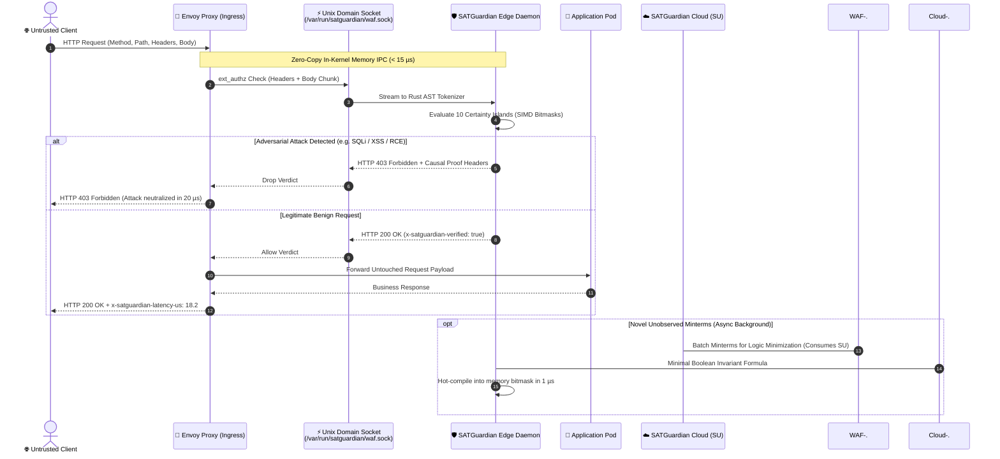

# ENVOY PROXY + SATGUARDIAN EDGE WAF: THE CLOUD-NATIVE CYBER-DEFENSE ALLIANCE

**Architectural Blueprint & Integration Guide**  
**Classification:** Enterprise Engineering Guide & Kubernetes Deployment Standard  
**Version:** v0.3.0 (Production Core)  
**Target Environments:** Kubernetes (EKS / GKE / AKS / Bare-Metal), Envoy Proxy 1.28+, Istio Service Mesh, Cilium Service Mesh.

---

## 1. The Strategic Alliance: The Aircraft Carrier & The Precision Interceptor

In enterprise infrastructure, **Envoy Proxy** has emerged as the undisputed **aircraft carrier** of the modern cloud: a battle-tested, hyper-scalable C++ data plane powering global telecommunications, banking, and hyperscale Kubernetes clusters. Envoy handles the heaviest operational burdens of network engineering:
- Non-blocking event loops with high-concurrency connection pooling.
- Universal protocol mediation: HTTP/1.1, HTTP/2, HTTP/3 (QUIC), and gRPC.
- Advanced TLS 1.3 termination and mutual TLS (mTLS).
- Distributed tracing (OpenTelemetry, Jaeger), metrics, and dynamic hot-restarts.

However, an aircraft carrier requires a precision defense system. Traditional perimeter defenses embedded into Envoy suffer from fatal architectural compromises:
- **Regex-based WAFs (ModSecurity / Coraza / CRS):** Impart severe regular expression backtracking penalties ($1.5\text{--}15\text{ ms}$), saturating Envoy's worker threads with CPU-bound regex loops and degrading throughput by up to $80\%$.
- **Cloud AI / LLM Wrappers:** Require routing customer payloads across external internet APIs, introducing catastrophic latency ($300\text{--}800\text{ ms}$), non-deterministic hallucination, and exorbitant inference costs ($\$2,500\text{ / 1M requests}$).

```
┌─────────────────────────────────────────────────────────────────────────────┐
│                       THE ARCHITECTURAL SYNERGY                             │
├──────────────────────────────────────┬──────────────────────────────────────┤
│ ENVOY PROXY (The Aircraft Carrier)   │ SATGUARDIAN EDGE (The Precision SAT) │
├──────────────────────────────────────┼──────────────────────────────────────┤
│ • C++ Event-driven Network Engine    │ • Deterministic Boolean SAT Engine   │
│ • HTTP/1.1, HTTP/2, HTTP/3, gRPC     │ • módulos de inspección en Rust        │
│ • TLS Termination & Connection Pool  │ • Sub-15 µs In-Kernel IPC (UDS)      │
│ • Zero-Loss Circuit Breaking         │ • Zero Regex Backtracking / ReDoS    │
│ • Kubernetes Ingress & Service Mesh  │ • 100% Free Edge / Sovereign Data    │
└──────────────────────────────────────┴──────────────────────────────────────┘
```

**SATGuardian Edge WAF** provides the perfect complementary weapon: a sub-millisecond, deterministic **Boolean Satisfiability (SAT)** engine written in Rust. Operating in local memory over a zero-copy Unix Domain Socket via Envoy's native `ext_authz` filter, SATGuardian verifies incoming payloads in **$< 0.05\text{ ms}$** ($0.02\text{ ms}$ typical) with **100% mathematical certainty** and zero stochastic drift.

---

## 2. Core Tenets: True Sovereignty vs. DNS CNAME Bastions

Most commercial cloud WAFs require organizations to point their root DNS CNAME records to third-party vendor servers (Cloudflare, AWS CloudFront, Fastly). For regulated enterprises (banking, healthcare, telecom, sovereign cloud), this model introduces unacceptable liabilities:
1. **Loss of Data Sovereignty:** Third-party cloud gateways terminate TLS and hold decryption keys to all customer traffic.
2. **Traffic Volumetric Tolls:** Vendors charge aggressive fees per gigabyte or per million requests, penalizing legitimate business growth.
3. **Single Point of Global Failure:** When the centralized CDN experiences an outage, all customer perimeters drop simultaneously.

### The SATGuardian + Envoy Paradigm
- **100% On-Premise & In-Mesh (Zero DNS CNAME):** Customer traffic enters directly into your own Envoy fleet. SATGuardian inspects requests locally. Customer payloads never leave your private boundary.
- **Unlimited Free Edge WAF:** Zero cost per request. Whether your Envoy instances process 1,000 or 100,000,000 requests per second, the local Edge WAF is 100% free and open-source.
- **Cloud Security Units (SU) for Boolean Synthesis:** You only pay for the optional cloud optimization service on `https://satguardian.tech`. When novel, unobserved attack patterns emerge, the Edge aggregates candidate minterms and dispatches them to the cloud engine to compute the minimal sum-of-products boolean formula. When your SU quota is reached, **the Edge never pauses protection**; it continues enforcing active compiled bitmasks at full line rate.

---

## 3. High-Throughput Kubernetes Sidecar Architecture

In a Kubernetes cluster, SATGuardian is deployed as a co-located sidecar container within the Envoy Pod or as a DaemonSet node agent.



### IPC Latency Comparison (Envoy to Security Filter)
| IPC Mechanism | Protocol | Serialization Overhead | Typical Latency | Throughput / Core |
| :--- | :--- | :--- | :---: | :---: |
| **SATGuardian Local UDS** | **HTTP/1.1 over UDS** | **Zero-Copy In-Kernel** | **$< 15\ \mu\text{s}$** | **$> 85,000\text{ req/s}$** |
| Remote gRPC Service | gRPC / HTTP/2 (TCP) | Protobuf serialize + network hop | $1.2\text{--}3.5\text{ ms}$ | $6,500\text{ req/s}$ |
| Out-of-Cluster HTTP | HTTP/1.1 (TCP/TLS) | TLS Handshake + JSON parse | $15\text{--}45\text{ ms}$ | $800\text{ req/s}$ |
| Centralized Cloud WAF | Public Internet (DNS CNAME)| Internet routing + Cloud processing | $80\text{--}350\text{ ms}$ | Rate-limited by vendor |

---

## 4. Production Deployment Configurations

The [`envoy/`](file:///d:/proyectos/rush/exactor-waf-guardian/envoy) directory contains ready-to-use production configurations:

### 1. Kubernetes Sidecar Deployment ([`envoy/kubernetes-sidecar.yaml`](file:///d:/proyectos/rush/exactor-waf-guardian/envoy/kubernetes-sidecar.yaml))
Deploy a multi-replica secured gateway using shared memory IPC:
```bash
kubectl apply -f envoy/kubernetes-sidecar.yaml
```
- Injects Envoy Proxy and SATGuardian Edge into the same Pod.
- Shares an `emptyDir` memory volume (`medium: Memory`) mounted at `/var/run/satguardian`.
- Enforces strict security contexts (`readOnlyRootFilesystem`, `drop: ALL` capabilities).

### 2. Standalone Envoy + UDS Configuration ([`envoy/envoy-uds.yaml`](file:///d:/proyectos/rush/exactor-waf-guardian/envoy/envoy-uds.yaml))
Configure an existing Envoy Proxy instance to verify traffic through SATGuardian's local Unix Domain Socket:
```bash
# 1. Start SATGuardian in Envoy ext_authz mode
satguardian-waf envoy-authz --socket /var/run/satguardian/waf.sock

# 2. Launch Envoy with UDS ext_authz filter
envoy -c envoy/envoy-uds.yaml
```

### 3. Rapid Local Evaluation with Docker Compose ([`envoy/docker-compose-envoy.yml`](file:///d:/proyectos/rush/exactor-waf-guardian/envoy/docker-compose-envoy.yml))
Launch a fully functioning 3-tier environment (Envoy Ingress on port 10000 + SATGuardian Edge WAF + Backend) with one command:
```bash
docker compose -f envoy/docker-compose-envoy.yml up -d
```
Test with a legitimate request:
```bash
curl -i "http://localhost:10000/api/search?q=enterprise_analytics"
# HTTP/1.1 200 OK
# x-satguardian-verified: true
# x-satguardian-latency-us: 14.8
```
Test with an adversarial SQL injection attempt:
```bash
curl -i "http://localhost:10000/api/search?id=1'%20OR%201=1--"
# HTTP/1.1 403 Forbidden
# x-satguardian-blocked: true
# x-satguardian-category: sql_injection
# x-satguardian-rule: SAT-SQLI-01
# x-satguardian-latency-us: 18.2
```

---

## 5. Header Synchronization & Observability

When SATGuardian inspects traffic on behalf of Envoy, it emits rich mathematical telemetry headers:

### Headers Injected Upstream (To Backend Application)
- `x-satguardian-verified: true`: Affirms that the request passed all 10 certainty islands without violation.
- `x-satguardian-latency-us: 18.2`: Exact clause resolution time in microseconds.
- `x-envoy-ext-authz: true`: Envoy provenance marker.

### Headers Injected Downstream (To Client on HTTP 403 Drop)
- `x-satguardian-blocked: true`: Indicates an intentional perimeter drop.
- `x-satguardian-category: sql_injection`: Attack taxonomy classification.
- `x-satguardian-rule: SAT-SQLI-01`: Exact formal invariant violated.
- `x-satguardian-event-id: 7c79fd7a`: Correlation ID mapped to immutable audit records in SQLite WAL.
- `x-satguardian-latency-us: 21.4`: Total verification latency.

### Envoy Access Logging Integration
Incorporate SATGuardian telemetry directly into Envoy's access log stream:
```yaml
access_log:
- name: envoy.access_loggers.file
  typed_config:
    "@type": type.googleapis.com/envoy.extensions.access_loggers.file.v3.FileAccessLog
    path: "/dev/stdout"
    log_format:
      text_format_source:
        inline_string: "[%START_TIME%] \"%REQ(:METHOD)% %REQ(X-ENVOY-ORIGINAL-PATH?:PATH)% %PROTOCOL%\" %RESPONSE_CODE% %BYTES_SENT% %DURATION%ms \"satguardian-verified:%RESP(x-satguardian-verified)%\" \"rule:%RESP(x-satguardian-rule)%\" \"sat-us:%RESP(x-satguardian-latency-us)%\"\n"
```

---

## 6. Summary: The Decoupled Cloud-Native Standard

By pairing **Envoy Proxy** with **SATGuardian Edge WAF**, organizations achieve the holy grail of modern application security:
1. **Zero Compromise on Speed:** Wire-rate inspection ($< 0.05\text{ ms}$, $> 52,000\text{ req/s}$ per core).
2. **Zero Compromise on Cost:** 100% free edge protection without volumetric per-request pricing.
3. **Zero Compromise on Sovereignty:** 100% on-premise execution; no DNS CNAME redirection or shared cloud bastions.
4. **Autonomous Intelligence:** Cloud Boolean minimization via Security Units (SU) at `https://satguardian.tech`, with zero downtime or traffic impact when quotas expire.
